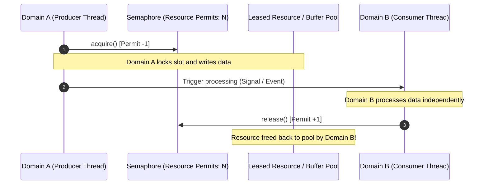
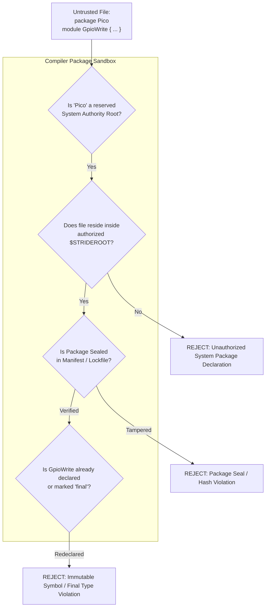

# Stride Architecture: Systems, Frameworks, Platforms, and Domains

This document formalizes the architectural layers in Stride, establishing the relationships and boundaries between **Systems**, **Frameworks**, **Platforms**, and **Domains**, as well as the **Package & Security Architecture**.

---

## 1. Architectural Taxonomy at a Glance

| Concept | What It Represents | Key Responsibilities | Examples |
| :--- | :--- | :--- | :--- |
| **Platform** | **Hardware Support** | Hardware descriptions, device pinouts, peripherals, registers, memory layouts, DMA controllers, interrupt vectors. | `RP2040`, `RP2350`, `STM32F4`, `Local_x86_64` |
| **Framework** | **Toolchain & Runtime** | Code emission targets, compiler backends, platform modules, language operator lowerings, runtime library bindings. | `JIT`, `Cpp`, `RtAudio`, `Wiring`, `PicoSDK` |
| **System** | **Deployment Topology** | Groups platforms and frameworks into a whole; declares abstract **Connections** between disparate execution targets. | `DesktopApp`, `DesktopAudioApp`, `DualCoreBldcSystem` |
| **Domain** | **Computation Group** | Execution context for signals, streams, and state machines; bound to a **Framework**; requires and provides **Resources**. | `AudioDomain`, `ControlDomain`, `GuiDomain`, `RootDomain` |

```mermaid
flowchart TD
    subgraph System ["System (Deployment Topology)"]
        direction TB

        subgraph PlatformPC ["Platform: PC Desktop (Hardware)"]
            FrameworkJIT ["Framework: JIT / Cpp (Toolchain)"]
            FrameworkJIT --> DomAudio ["Domain: AudioDomain (Real-time)"]
            FrameworkJIT --> DomControl ["Domain: ControlDomain (Asynchronous)"]
        end

        subgraph PlatformMCU ["Platform: RP2350 / STM32 (Hardware)"]
            FrameworkMCU ["Framework: PicoSDK / BareMetal (Toolchain)"]
            FrameworkMCU --> DomDSP ["Domain: DspDomain (Cortex-M33 Core 0)"]
            FrameworkMCU --> DomIO ["Domain: IoDomain (Hazard3 Core 1)"]
        end

        DomControl -.->|"Connection (Serial / USB / Protobuf)"| DomDSP
        DomDSP -.->|"Connection (Shared SRAM / DMA / zpad)"| DomIO
    end
```

---

## 2. Platforms: Hardware Support

A **Platform** (`platform`) encapsulates target hardware capabilities and physical resources. It does not dictate how C++ or LLVM IR is generated; instead, it defines the physical substrate:

- **Target Microcontrollers & CPUs**: Processor cores (ARM Cortex-M, RISC-V, x86_64), clock frequencies, cache structures.
- **Memory Topology**: Base addresses, SRAM banks, flash boundaries, tightly-coupled memories (TCM), zero-latency scratchpads (zpads).
- **Hardware Peripherals**: DMA engines, channels, GPIO configurations, timer counters, UART/SPI/I2C controllers.
- **Interrupt Routing**: NVIC/PLIC interrupt vector mappings and priority schemes.

Platforms are declared in `platforms/<Target>/`:
```stride
platform _PicoPlatform {
    framework: "Pico"
    frameworkVersion: "1.0"
    hardware: "RP2040"
    hardwareVersion: "1.0"
}
```

### 2.1 Toolchain Dependencies & Automated CLI Downloads
Platforms often require external cross-compilers, vendor SDKs, and hardware utilities to build and deploy code:
- **ARM / RISC-V Cross-Compilers**: `arm-none-eabi-gcc`, `clang`, `riscv-none-elf-gcc`.
- **Vendor SDKs & HALs**: Raspberry Pi `pico-sdk`, ST `STM32Cube_FW`, Arduino core libraries, vendor CMSIS packs.
- **Flashing & Debug Utilities**: `openocd`, `picotool`, `dfu-util`.

Stride accommodates two toolchain provisioning strategies:
1. **Host-Installed Toolchain Discovery**:
   - Stride defines tool discovery templates in `$STRIDEROOT/tools/*.stride` (`toolTemplate`, `pathTemplate`, `pathSearch`).
   - `ToolManager` automatically scans standard system directories (e.g. `/usr/bin`, `~/STM32Cube/Repository/`, `C:/Program Files/...`) to discover pre-installed compilers and SDKs, recording active paths in `$STRIDEROOT/local/`.
2. **Automated On-Demand Provisioning via Stride CLI**:
   - When a required toolchain or vendor library is not found on the developer's workstation, platforms and frameworks declare bootstrap instructions via `_frameworkConfiguration` (`installation: [ installAction ... ]`).
   - The Stride command-line manager (`stride --install <name>` / `strdtools -i <name>`) can automatically download, verify, and configure the necessary toolchain archives, git repositories, or firmware SDKs.
   - Downloaded toolchains are isolated into the local Stride environment, ensuring reproducible builds across host machines without requiring manual environment variable setup.

---

## 3. Frameworks: Toolchains & Runtimes

A **Framework** (`_frameworkDescription`) defines the execution environment, code generator, and runtime toolchain. **Domains are always tied to a framework.**

Key aspects of a Framework:
- **Code Emission Mode**:
  - Direct template lowering (`domainFunctionCode`, `domainInitializationCode`, C++ files compiled via CMake/make).
  - JIT compilation directly to LLVM IR functions via `stridejit`.
  - Bare-metal / RTOS tasks (FreeRTOS, Zephyr, Pigweed).
- **Platform Modules & Operator Implementations**:
  - Provides native implementations for primitive operators (`+`, `-`, `*`, `/`, `Sin`, `Clamp`) and hardware-specific optimizations (CMSIS-DSP, AVX2, NEON).
- **Runtime Libraries**:
  - Audio backends (RtAudio, ALSA, CoreAudio, WASAPI), serial transports, memory allocators.

Example framework association:
```stride
_domainDefinition AudioDomain {
    framework: _JitFramework
    rate: 48000.0
    ...
}
```

---

## 4. Domains: Computation Groups & Resource Scopes

A **Domain** (`_domainDefinition`) is an execution and scheduling context. It groups computations (signals, streams, reactions, state machines) that share temporal characteristics and resource access.

### 4.1 Invariants of a Domain
1. **Always Tied to a Framework**: A domain's algorithmic expressions are lowered according to its specified framework (`framework: ...`).
2. **Resource Boundaries**:
   - `requiresResources`: Hardware or system capabilities required to run the domain (e.g. `_RootContext`, a specific thread, DMA channel, or memory block).
   - `providesResources`: Capabilities made available to child subdomains or external hosts (e.g. `_MainFunction`, event queue).
3. **Signal Ownership**:
   - A signal declared with `domain: <DomainName>` is owned by that domain.
   - The owning domain resets the signal to its `default` value during its setup/init phase and acts as the native mutation site.
4. **Hierarchical Subdomains (`parentDomain`)**:
   - Subdomains inherit context and resources from their parent domain, enabling nested computation groups.
5. **Standardized Lifecycle Functions**:
   - `<Domain>_load()`: Global one-shot preparation (runs `onLoad` streams; thread-safe atomic CAS guard).
   - `<Domain>_init(void *state)`: Instance reset (runs `onInit` streams, applies default values, resets state machines and buffers).
   - `<Domain>_process(...)`: Continuous or event-driven execution tick (evaluates domain streams, reactions, and active state machine transitions).
   - `<Domain>_cleanup(void *state)`: Optional teardown and resource release.

### 4.2 Autonomous Subdomains & Parent Resource Provisioning
When an autonomous domain is not the root domain, its **parent domain is where autonomy is granted and resources are provided for it**:
- **Execution Resource Ownership**: The parent domain owns and provisions the execution vehicle required by the autonomous child (e.g. allocating a `_Thread` resource, creating an OS worker thread, setting up a hardware timer interrupt, or delegating to an RTOS task).
- **Shared Memory Context**: The parent domain hosts the shared memory resource (`_RootContext`, shared heap, or inter-thread buffer) accessible to both the parent and its subdomains.
- **Lifecycle Coordination**: The parent domain manages the child domain's runtime life cycle: `<Parent>_init` starts the autonomous worker thread or task, and `<Parent>_cleanup` signals termination and joins the thread. Autonomy is therefore not an unmanaged free-for-all; it is an explicitly delegated capability anchored in the parent domain's resource contract.

---

## 5. Systems & Abstract Connections

A **System** (`system`) is the top-level deployment unit that composes multiple platforms and frameworks.

### 5.1 Abstract Connections (`connection`)
When signals or streams cross domain boundaries where implicit shared memory does not exist, or where explicit communication mechanics are required, a **`connection`** specifies the bridge.

```stride
connection _PCToWiringSerial {
    sourceFramework: _PCPlatform
    sourceDomains: [ "ControlDomain" ]
    destinationFramework: _WiringPlatform
    destinationDomains: [ "WiringDomain" ]
    sourceImports: [ "Serial" ]
    sourceStreams: [
        _Connection_Token >> SerialOut[0];
    ]
    destinationImports: [ "Serial" ]
    destinationStreams: [
        Wiring::SerialIn[0] >> _Connection_Token;
    ]
}

system DesktopAudioApp {
    platforms: [_WiringPlatform, _PCPlatform]
    connections: [_PCToWiringSerial]
}
```

### 5.2 Spectrum of Connection Mechanisms
Connections describe how data and events move across boundaries, spanning all hardware and software topologies:

1. **Shared Address Space (Level 1 / Intrinsic - Same Process or Common Parent)**:
   Even within a shared memory space (`_RootContext`), different access patterns require specific synchronization mechanisms:
   - **1A. Plain Direct Memory (Level 1 POC)**: Zero-overhead direct pointer dereference or register passing without locks, mutexes, or FIFOs. Suitable for single-threaded sibling domains, lock-free scalar reads, or cooperative coroutines.
   - **1B. Mutex-Protected Shared State**: Used when concurrent asynchronous domains concurrently read and write multi-variable bundles, structured tables, or non-atomic state blocks, guaranteeing transactional consistency and preventing race conditions or torn reads.
   - **1C. FIFO / Lock-Free Ring Buffering (SPSC / MPMC)**: Used when streaming data or event sequences must be preserved losslessly without dropping samples across asynchronous rates (e.g. 48 kHz Audio generating samples consumed by a 60 Hz UI or ML domain, or incoming serial packets queued for a game loop).
   - **1D. Double / Triple Buffering**: Lockless latest-wins state exchange (e.g., frame peeking, oscilloscope views, display buffers, parameter snapshots) where older unread data can be safely overwritten by newer updates without blocking the producer.
2. **Inter-Thread / Intra-Process (Level 2 - Concurrency & Synchronization)**:
   - Condition variables / counting semaphores (reactive event notifications, task wakeups).
   - Thread notifications (`pw_sync`, FreeRTOS task notifications).
3. **Hardware-Driven / On-Chip (Level 3 - MPUs / Heterogeneous Cores)**:
   - **DMA Transfers**: Automatic circular DMA buffers with half-transfer (HT) and transfer-complete (TC) interrupts.
   - **Zero-Latency Scratchpads (zpads) / Tightly-Coupled Memory (TCM)**: Physically contiguous dual-port SRAM with explicit cache invalidate/flush instructions.
   - **Inter-Processor Interrupts (IPI) & Hardware Mailboxes**: Single-cycle core-to-core signaling between heterogeneous cores (e.g. Cortex-A + Cortex-M).
4. **Distributed / Inter-Platform (Level 4)**:
   - Peripheral buses: UART, SPI, I2C, CAN, PCIe.
   - Network transports: Ethernet, Wi-Fi, BLE, TCP/UDP sockets.
   - Structured RPC: Pigweed RPC, gRPC, Protobuf serialization.

### 5.3 Asymmetric Resource Hand-off & Semaphores

A critical concurrency challenge in multi-threaded systems occurs when **a resource locked or acquired by one domain must be freed or released by another domain running on a separate thread**.

#### The Mutex Ownership Dilemma
In standard POSIX (`pthread_mutex_unlock`), C++ (`std::mutex`), and RTOS environments, a mutex has **strict thread ownership**. The thread that acquires the mutex *must* be the thread that releases it. If Domain A (running on Thread A) locks a mutex and Domain B (running on Thread B) attempts to unlock it, the result is undefined behavior or a fatal runtime error (`EPERM`).

#### The Semaphore Solution (No Thread Ownership)
A **Counting or Binary Semaphore** (`std::counting_semaphore`, POSIX `sem_t`, FreeRTOS `SemaphoreHandle_t`, or Pigweed `pw_sync::CountingSemaphore`) has **no thread ownership**:
- **Domain A** executes `acquire()` (or `wait()`) to claim a resource slot.
- **Domain B** (or an interrupt service routine on a different thread) executes `release()` (or `post() / give()`) to return the resource.



#### Modeling Semaphores in Stride

Stride covers semaphore-governed hand-offs at three levels:

1. **Resource Definition (`resource` declaration)**:
   A shared resource can specify semaphore synchronization and instance pooling:
   ```stride
   resource DmaBufferPool {
       maxInstances: 2           # Bounded capacity (e.g. ping-pong double buffer)
       synchronization: Semaphore # Governed by a counting semaphore
       exclusive: on
   }
   ```
   The compiler instantiates a counting semaphore initialized to `maxInstances`. Acquiring a permit is required to enter or allocate from the resource, and permits can be returned by any domain holding a lease.

2. **Declarative Connection Hand-offs (`connection`)**:
   In high-level system connections where streams cross asynchronous domains:
   ```stride
   connection AudioToWorker {
       sourceDomains: [ "AudioDomain" ]
       destinationDomains: [ "WorkerDomain" ]
       mechanism: Handoff {
           sync: Semaphore
           capacity: 2
       }
   }
   ```
   The compiler automatically synthesizes:
   - An `acquire` call in the producer domain before writing.
   - An automated `release` call in the consumer domain upon completion of its processing tick or reaction.

3. **Explicit Token Control (`Res.acquire` & `Res.release`)**:
   For algorithms requiring fine-grained dataflow control:
   ```stride
   # Producer Domain: wait for an available buffer in the pool
   BufferPool.acquire >> reaction {
       streams: [
           SensorIn >> BufferPool.buffer;
           BufferPool.ready >> WorkerTrigger;
       ]
   };

   # Consumer Domain: when reaction finishes, release the buffer permit back to the pool
   WorkerReaction.done >> BufferPool.release;
   ```

#### Backend Lowering
- **C++ Framework**: Lowered to C++20 `std::counting_semaphore<N>` or `std::binary_semaphore`.
- **Embedded / RTOS (FreeRTOS, Zephyr, Pico)**: Lowered to `xSemaphoreCreateCounting`, `xSemaphoreTake`, and `xSemaphoreGive` (or `pw_sync::CountingSemaphore`).
- **JIT / LLVM IR**: Lowered via external runtime helper functions (`stride_sem_acquire`, `stride_sem_release`) linked via `StrideEnvironment`, or native platform atomic futexes.

---

## 6. Packages vs. `rootNamespace` & Symbol Security

### 6.1 Deprecation of `rootNamespace` in Favor of `package`
In legacy Stride systems, platforms frequently declared an ad-hoc property:
```stride
platform _WiringPlatform {
    ...
    rootNamespace: "Wiring"  # Deprecated
}
```
`rootNamespace` was a compiler workaround that forcibly prepended a string prefix onto AST nodes during system loading to prevent symbol name collisions.

**Modern Architecture**:
- **`rootNamespace` is eliminated.**
- Namespacing is governed entirely by the first-class **`package`** keyword and standard filesystem hierarchy:
  - Files declare their logical package explicitly:
    ```stride
    package Pico::GPIO
    ```
  - Alternatively, files inside capitalized directory trees derive their package naturally from their relative path (e.g. `platforms/Pico/Devices/RP2040.stride` derives `Pico::Devices::RP2040`).
  - Consumers import and alias packages cleanly at the call site:
    ```stride
    import Pico::GPIO as Pin
    import Wiring::Serial as Comms
    ```

---

### 6.2 Package Security: Preventing Malicious Symbol Injection

Allowing arbitrary files to declare packages introduces serious security vectors if unconstrained:
- **Namespace Poisoning**: An untrusted third-party dependency declares `package Stride::Core` or `package Pico::Hardware` and replaces genuine drivers (`Pico::GpioWrite`) or mathematical operators with trojaned versions.
- **Dependency Confusion & Shadowing**: A local file `Pico.stride` in the project directory shadowing the system platform SDK.
- **Private Member Pollution**: Injecting external variables into internal state structs.

To prevent malicious symbol injection, Stride enforces five architectural security boundaries:



#### 1. Sealed Packages (No Arbitrary Namespace Reopening)
In open-namespace languages (like C++ or Ruby), any file can reopen `namespace std` and inject symbols. 
In Stride:
- **Packages are sealed by default.** A package can only be defined within its designated source directory tree or declared manifest root.
- User application code or third-party packages cannot declare or reopen system packages (`package Stride::*`, `package Pico::*`, `package STM32::*`). Attempting to do so triggers a compile-time error:
  > `Error: Cannot declare 'package Pico' outside the authorized platform directory ($STRIDEROOT/platforms/Pico).`

#### 2. Authority Roots & Reserved Namespaces
The compiler maintains a strict registry of **Authority Roots**:
- System-level roots (`Stride`, `Buffer`, `Math`, `System`, `Platform`) can only be loaded from verified `$STRIDEROOT` paths.
- Hardware platform namespaces are locked to the active platform directory specified by `use` or `platform`.

#### 3. Immutable Symbol Tables & `final` Keyword
- Once a declaration is registered in a package's symbol table, it is **immutable**. Subsequent attempts to redefine, shadow, or monkey-patch the symbol produce a `SymbolRedeclarationError`.
- Types and platform modules marked **`final`** (via `Schema.stride`) cannot be extended, inherited, or overridden by external packages.

#### 4. Cryptographic Integrity via Lockfiles (`stride.lock`)
- For external or third-party packages, the build system computes SHA-256 hashes for all source files in the package directory upon installation.
- During compilation, `stridegen` verifies package directory hashes against `stride.lock`. If any file within a package has been modified or injected, compilation halts immediately with an integrity violation.

#### 5. Strict Visibility (`public: off` / Encapsulation)
- Symbols without explicit `public` visibility remain strictly internal to the package. They cannot be targeted by external stream writes, dynamic lookups, or cross-package member accesses (`Pkg::InternalSignal` is rejected at compile time).
