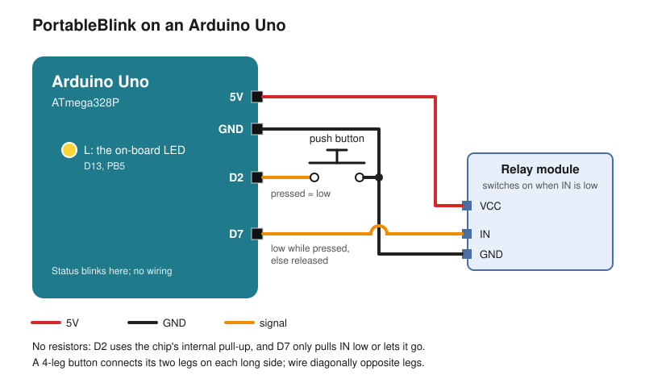
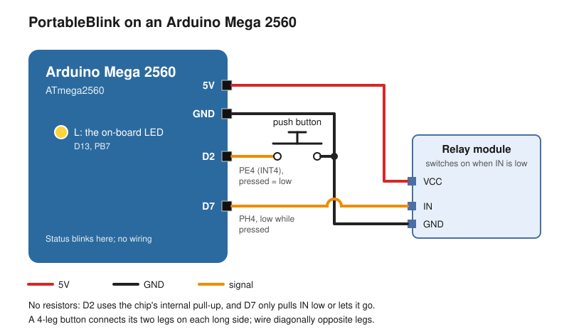

# PortableBlink

Blinks an Arduino Uno's on-board LED from the main loop, and drives a relay
module from a button polled by a 1 kHz timer. It shows how a Stride program
uses pins without naming a board.


| File | What it is |
|---|---|
| `PortableBlink.stride` | The program. It uses `BlinkRig::Status`, `BlinkRig::Button` and `BlinkRig::Relay` through `DigitalIO::Led`, `DigitalIn` and `DigitalOut`, in the standard `PlatformLoopDomain` and `PlatformTimerDomain`. |
| `BlinkRig.stride` | The project's hardware file for an Arduino Uno. It overlays `ArduinoUno` and declares how each pin is used (`gpioPin`). This is the only file that names the board. |
| `BlinkRigMega.stride` | The same signals on an Arduino Mega 2560. |
| `wiring-uno.svg`, `wiring-mega.svg` | How to connect the parts. |

## Wiring



| Signal | Uno | Mega 2560 | Wiring |
|---|---|---|---|
| `Status` | `LED` (D13, PB5) | `LED` (D13, PB7) | The on-board LED marked L. Nothing to wire. |
| `Button` | D2 (PD2) | D2 (PE4) | A push button between D2 and GND. No resistor: the chip's internal pull-up holds D2 high, so a press reads low. |
| `Relay` | D7 (PD7) | D7 (PH4) | The IN pin of an active-low relay module. Its VCC goes to 5V and its GND to GND. D7 pulls IN low while the button is pressed and lets it go otherwise. |

A 4-leg tactile button connects the two legs on each long side, so wire
diagonally opposite legs. The program doesn't debounce the button, so the
relay may chatter for a few milliseconds when it is pressed or released.



## Build and flash

```sh
stride build PortableBlink.stride            # PortableBlink.hex and .elf
stride flash PortableBlink.stride --port=COM3
```

`stride build` finds `BlinkRig` next to the program first, then the board it
overlays in `platforms/AVR/boards`. It needs avr-gcc, which the Arduino IDE
installs (`stride doctor` shows where it was found).

### On an Arduino Mega 2560

Change the two hardware lines at the top of `PortableBlink.stride`:

```stride
use AVR version 1.0 on BlinkRigMega
import BlinkRigMega as BlinkRig
```

The rest of the program stays as it is: `BlinkRig::Status` now means
`BlinkRigMega.stride`'s `Status`. Build and flash the same way.

## What the compiler does with it

- **Checks the wiring against the chip.** Writing `pull: Gpio::PullDown` on
  the button fails with `pull PullDown is not supported by ATmega328P pin
  PortD.2 (supported: PullNone, PullUp)`. Using D0 or D1 fails too, because
  the runtime reserves them for the USB serial port.
- **Sets every pin up once at startup**, before any domain runs. It writes
  the levels first, then the pull-up, then the directions, so the relay
  never clicks at reset.
- **Turns each pin access into direct register access** at constant
  addresses, with no runtime calls. The startup writes are single
  `sbi`/`cbi` instructions. A write of a level known only at run time, such
  as the blink or the relay, is a read-modify-write: `in`, `andi`, `or`,
  `out`.
- **Sleeps cooperatively.** `Sleep(domain: PlatformLoopDomain)` suspends
  only the loop, so the timer keeps polling the button while the LED waits.

## Porting it

Move the signals to other pins by editing the `pin:` labels in the hardware
file. For another board, copy `BlinkRig.stride` the way `BlinkRigMega.stride`
does: overlay the new board, use its labels, and point the program's `use`
line and `import ... as BlinkRig` at the new file.

On the Mega, D7 is on port H, whose registers sit in the extended I/O space
(0x100 to 0x102). `sbi`/`cbi` and `in`/`out` reach only the low I/O space, so
port H is read and written with `lds`/`sts`. Each relay write takes two more
cycles and two more words of flash than on the Uno, and the startup writes
become `lds`, `ori` or `andi`, `sts` instead of one `sbi`/`cbi`. Such a
read-modify-write can be interrupted between its read and its write. That is
safe here, because the timer domain runs from the main loop and no interrupt
writes PORTH.
