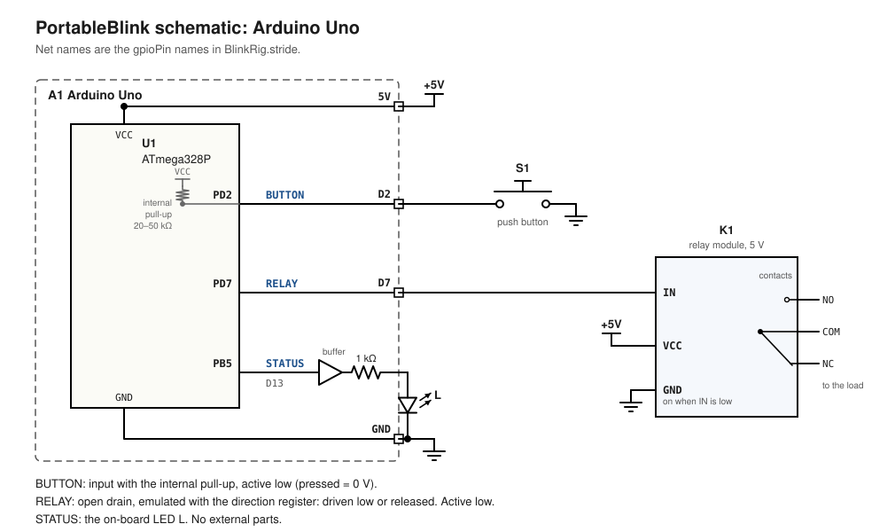
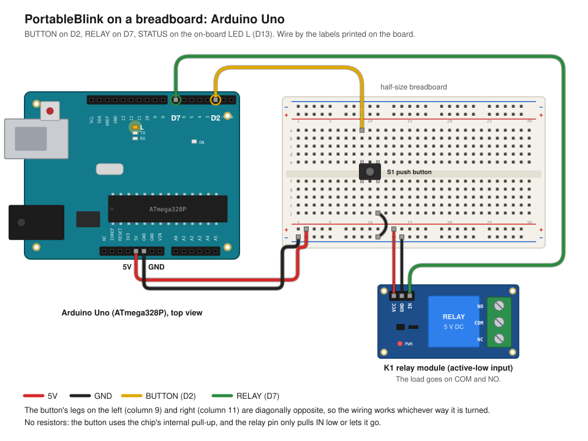
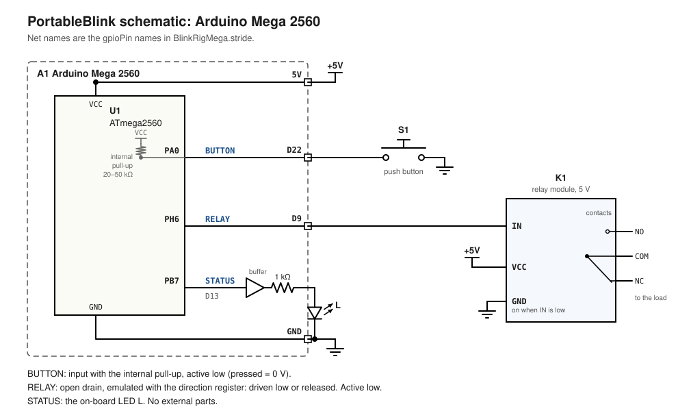
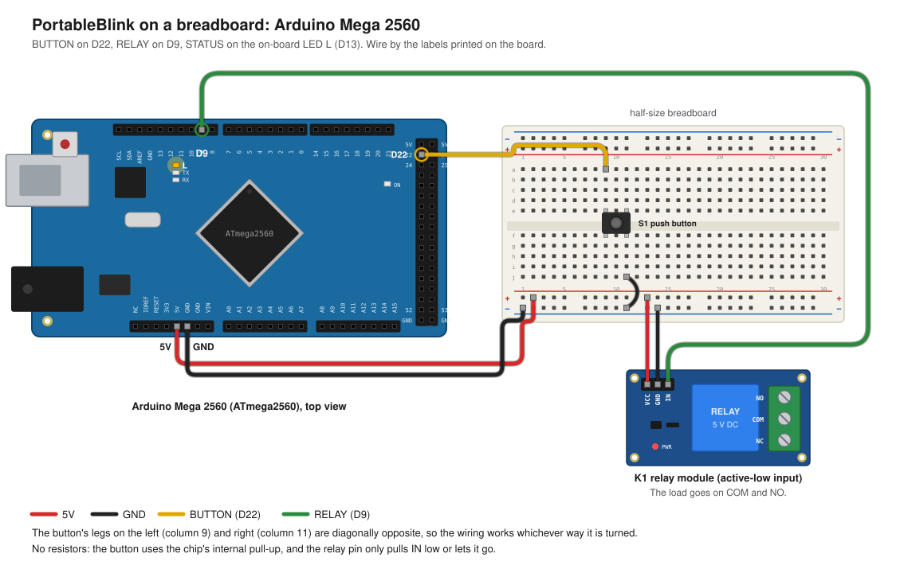

# PortableBlink

Blinks the board's on-board LED from the main loop, prints a tick count over
serial, and drives a relay module from a button polled by a 1 kHz timer. It
shows how a single Stride program runs across AVR (Arduino Uno, Arduino Mega
2560) and Pico (Raspberry Pi Pico, Raspberry Pi Pico 2) boards using `feature`
variants and hardware rig files.

| File | What it is |
|---|---|
| `PortableBlink.stride` | The program. It uses `BlinkRig::Status`, `BlinkRig::Button` and `BlinkRig::Relay` through `DigitalIO::Led`, `DigitalIn` and `DigitalOut`, plus `Format`/`PrintLn`, in the standard `PlatformLoopDomain` and `PlatformTimerDomain`. |
| `BlinkRig.stride` | Hardware rig for Arduino Uno (`ArduinoUno`). |
| `BlinkRigMega.stride` | Hardware rig for Arduino Mega 2560 (`ArduinoMega2560`). |
| `BlinkRigPico.stride` | Hardware rig for Raspberry Pi Pico (`RaspberryPiPico`). |
| `BlinkRigPico2.stride` | Hardware rig for Raspberry Pi Pico 2 (`RaspberryPiPico2`). |
| `BlinkRigSTM32F4Discovery.stride` | Hardware rig for STM32F4DISCOVERY (`STM32F4Discovery`). |
| `BlinkRigSTM32F746GDiscovery.stride` | Hardware rig for STM32F746G-DISCO (`STM32F746GDiscovery`). |
| `schematic-uno.svg`, `schematic-mega.svg` | The circuit for the AVR boards. |
| `breadboard-uno.svg`, `breadboard-mega.svg` | The parts on a breadboard, wired to the AVR boards. |

## Wiring

Each rig maps the same logical signals (`Status`, `Button`, `Relay`) to that
board's pins. The program names only the signals.

| Signal | Uno | Mega 2560 | Pico / Pico 2 | Wiring |
|---|---|---|---|---|
| `Status` | `LED` (D13, PB5) | `LED` (D13, PB7) | `LED` (GP25) | The on-board LED. Nothing to wire. |
| `Button` | D2 (PD2) | D22 (PA0) | GP2 | A push button between the pin and GND. No resistor: the chip's internal pull-up holds the pin high, so a press reads low. |
| `Relay` | D7 (PD7) | D9 (PH6) | GP7 | The IN pin of an active-low relay module (VCC to 5V / 3.3V, GND to GND). The pin pulls IN low while the button is pressed and lets it go otherwise. |

A 4-leg tactile button connects the two legs on each long side, so wire
diagonally opposite legs. The program doesn't debounce the button, so the
relay may chatter for a few milliseconds when it is pressed or released.

The net names in the schematics are the `gpioPin` names in the hardware
file.

### Arduino Uno





### Arduino Mega 2560

On the Mega the button is on D22, in the double header at the end of the
board, and the relay is on D9.





## Build and flash

Select the target board with `-D Board::<Variant>` (`Uno` is the default):

```sh
stride build PortableBlink.stride                     # Arduino Uno (.hex / .elf)
stride build PortableBlink.stride -D Board::Mega      # Arduino Mega 2560 (.hex / .elf)
stride build PortableBlink.stride -D Board::Pico      # Raspberry Pi Pico (.uf2 / .elf)
stride build PortableBlink.stride -D Board::Pico2     # Raspberry Pi Pico 2 (.uf2 / .elf)
stride build PortableBlink.stride -D Board::F4Disco   # STM32F4DISCOVERY (.bin / .hex / .elf)
stride build PortableBlink.stride -D Board::F746Disco # STM32F746G-DISCO (.bin / .hex / .elf)

stride flash PortableBlink.stride --port=COM3                 # Flash Uno via serial
stride flash PortableBlink.stride -D Board::Mega --port=COM3  # Flash Mega via serial
stride flash PortableBlink.stride -D Board::Pico              # Flash Pico via picotool
stride flash PortableBlink.stride -D Board::Pico2 --probe     # Flash Pico 2 via SWD probe
stride flash PortableBlink.stride -D Board::F4Disco           # Flash STM32F4DISCOVERY via ST-Link (OpenOCD)
stride flash PortableBlink.stride -D Board::F746Disco         # Flash STM32F746G-DISCO via ST-Link (OpenOCD)
```

`stride build` finds the `BlinkRig*` file next to the program first, then the
board it overlays in `platforms/<Platform>/boards`. AVR builds use `avr-gcc`
(installed by Arduino IDE); Pico builds use `pico-sdk` and `arm-none-eabi-gcc`
(`stride doctor` shows what is installed).

## What the compiler does with it

- **Checks the wiring against the chip.** Writing `pull: Gpio::PullDown` on
  the button fails with `pull PullDown is not supported by ATmega328P pin
  PortD.2 (supported: PullNone, PullUp)`. Using D0 or D1 fails too, because
  the runtime reserves them for the USB serial port.
- **Sets every pin up once at startup**, before any domain runs. It writes
  the levels first, then the pull-up, then the directions, so the relay
  never clicks at reset.
- **Turns each pin access into direct register access** at constant
  addresses, with no runtime calls. The startup writes are single
  `sbi`/`cbi` instructions. A write of a level known only at run time, such
  as the blink or the relay, is a read-modify-write: `in`, `andi`, `or`,
  `out`.
- **Sleeps cooperatively.** `Sleep(domain: PlatformLoopDomain)` suspends
  only the loop, so the timer keeps polling the button while the LED waits.

## Porting it

Move the signals to other pins by editing the `pin:` labels in the hardware
file. For another board, copy `BlinkRig.stride` the way `BlinkRigMega.stride`
does: overlay the new board, use its labels, and point the program's `use`
line and `import ... as BlinkRig` at the new file.

On the Mega, D9 is on port H, whose registers sit in the extended I/O space
(0x100 to 0x102). `sbi`/`cbi` and `in`/`out` reach only the low I/O space, so
port H is read and written with `lds`/`sts`. Each relay write takes two more
cycles and two more words of flash than on the Uno, and the startup writes
become `lds`, `ori` or `andi`, `sts` instead of one `sbi`/`cbi`. Such a
read-modify-write can be interrupted between its read and its write. That is
safe here, because the timer domain runs from the main loop and no interrupt
writes PORTH.
