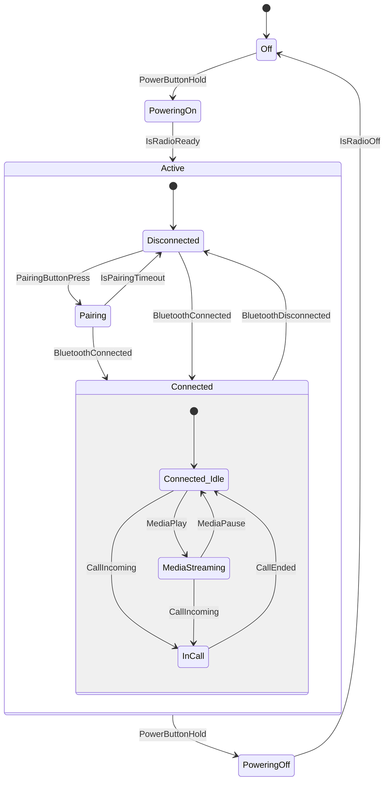

# Stride State Machine Formalization

This document outlines the declarative State Machine syntax for the Stride language, detailing the core schema and applied use cases. The schema provides structural completeness with respect to standard UML Statecharts and W3C SCXML formalizations.

## Core Schema (`StateMachine.stride`)
**Path:** `strideroot/library/1.0/StateMachine.stride`

The core library defines two universal base types: `_StateType` and `_TransitionType`.

### Architectural Principles
- **Backend-Agnostic Design:** The schema is declarative, defining properties rather than execution logic. The Stride compiler determines the implementation, generating either flattened `enum`/`switch` branching for embedded MCUs or polymorphic classes (State Object Pattern) for high-level runtime environments.
- **Stream-Driven Actions:** Lifecycle hooks (`onEntry`, `onProcess`, `onExit`) and transition `actions` strictly accept constrained lists of `_StreamType`. Encapsulating continuous logic within `onProcess` prevents the need for external polling streams.

## State Lifecycle & Execution Semantics
When a state machine processes data, it adheres strictly to the following structural and lifecycle rules:

### Lifecycle Hooks
- `onEntry`: Stream expressions executed exactly once when the state becomes active. If the state contains child states, the parent's `onEntry` is executed before the child's `onEntry` (Top-Down).
- `onProcess`: Stream expressions executed continuously (e.g., per tick or event loop) as long as the state remains active.
- `onExit`: Stream expressions executed exactly once when the state is deactivated. When exiting a hierarchical state, the child's `onExit` executes before the parent's `onExit` (Bottom-Up).

### Transitions, Preemption & Completion
Transitions dictate how the state machine moves from one state to another. They are evaluated sequentially based on their definition order in the `transitions` list.

**Internal Transitions vs Self-Transitions**
- **Internal Transitions:** Defined by entirely omitting the `newState` property. When triggered, the transition's `actions` are executed, but the state machine remains in the current state. **`onExit` and `onEntry` are NOT called.**
- **Self-Transitions:** Defined when `newState` points to the *current* state. When triggered, the transition acts externally: the state's `onExit` is called, the transition `actions` execute, and the state's `onEntry` is called again.

**Transition Evaluation Order & Hierarchical Preemption**
- **Order of Evaluation:** If multiple transitions have their `signal` and `condition` met simultaneously, the transition defined *highest* in the `transitions` list is executed.
- **Hierarchical Preemption:** Parent state transitions take precedence over child state transitions. If a parent transition fires, the active child state is preempted. The child's `onExit` hook runs, followed by the parent's `onExit` hook, before the transition completes.

**Completion Transitions (`isFinal` and `onDone`)**
When a child state marked `isFinal: on` is reached, it signals completion to the parent state. The parent will then evaluate its `onDone` transitions.
- *Parallel Synchronization:* If the parent is an orthogonal state (`isParallel: on`), the parent will NOT evaluate `onDone` until *every* parallel region has reached its respective `isFinal: on` state.

### Orthogonality & History
**Orthogonal Regions (`isParallel: on`)**
When `isParallel: on` is specified, all child states in the `states` list become active simultaneously (rather than just the `initialState`).
- *Exiting:* If the parent state transitions out, *all* active parallel child states have their `onExit` hooks called before the parent exits. 

**History Pseudo-states (`resumeLastState: on`)**
Instructs the state machine to remember the active child hierarchy when the state is exited. Upon re-entry, it restores the hierarchy instead of starting at `initialState`.
- *First Entry:* If the state has never been entered, it defaults to the `initialState`.
- *Final States:* If the state previously reached an `isFinal: on` child state before exiting, re-entry defaults back to the `initialState` (the history is cleared upon completion).

## Implementation Example (Bluetooth Headset)

The following example demonstrates how the Stride syntax models a complex embedded system (a Bluetooth headset). It illustrates hardware hooks (`onEntry`/`onExit`), continuous data streams (`onProcess`), and hierarchical preemption.



```stride
# Shared hardware signals/events used by the transitions
blocks: [
    signal PowerButtonHold { type: _IntType }
    signal BluetoothConnected { type: _IntType }
    signal BluetoothDisconnected { type: _IntType }
    signal CallIncoming { type: _IntType }
    signal CallEnded { type: _IntType }
    signal MediaPlay { type: _IntType }
    signal MediaPause { type: _IntType }
    signal PairingButtonPress { type: _IntType }
]

state BluetoothHeadset {
    states: [Off, PoweringOn, Active, PoweringOff]
    initialState: Off
}

state Off {
    onEntry: [ on >> EnterDeepSleep(); ]
    
    transitions: [
        transition {
            signal: PowerButtonHold
            newState: PoweringOn
        }
    ]
}

state PoweringOn {
    onEntry: [ 
        on >> WakeRadio(); 
        on >> PlayPowerOnChime(); 
    ]
    
    transitions: [
        transition {
            condition: IsRadioReady
            newState: Active
        }
    ]
}

state PoweringOff {
    onEntry: [ 
        on >> PlayPowerOffChime(); 
        on >> DisconnectRadio(); 
        on >> EnterDeepSleep(); 
    ]
    
    transitions: [
        transition {
            condition: IsRadioOff
            newState: Off
        }
    ]
}

# The Active state is hierarchical. 
# A PowerButtonHold transition here acts globally for all sub-states, 
# preempting them and routing to PoweringOff.
state Active {
    states: [Pairing, Disconnected, Connected]
    initialState: Disconnected
    
    transitions: [
        transition {
            signal: PowerButtonHold
            newState: PoweringOff
        }
    ]
}

state Pairing {
    onEntry: [ 
        on >> EnableDiscoverableMode(); 
        on >> PlayPairingPrompt(); 
    ]
    onProcess: [ on >> FlashBlueRedLED(); ]
    onExit: [ on >> DisableDiscoverableMode(); ]
    
    transitions: [
        transition {
            signal: BluetoothConnected
            newState: Connected
        },
        transition {
            condition: IsPairingTimeout
            newState: Disconnected
        }
    ]
}

state Disconnected {
    onProcess: [ on >> FlashBlueLED_Slow(); ]
    
    transitions: [
        transition {
            signal: BluetoothConnected
            newState: Connected
        },
        transition {
            signal: PairingButtonPress 
            newState: Pairing
        }
    ]
}

# The Connected state handles distinct operational modes (media vs calls)
state Connected {
    states: [Connected_Idle, MediaStreaming, InCall]
    initialState: Connected_Idle
    
    onEntry: [ on >> PlayConnectedChime(); ]
    onExit: [ on >> PlayDisconnectedChime(); ]
    
    transitions: [
        transition {
            signal: BluetoothDisconnected
            newState: Disconnected
        }
    ]
}

state Connected_Idle {
    onProcess: [ on >> DoubleFlashBlueLED(); ]
    
    transitions: [
        transition {
            signal: MediaPlay
            newState: MediaStreaming
        },
        transition {
            signal: CallIncoming
            newState: InCall
        }
    ]
}

state MediaStreaming {
    onEntry: [ on >> ConfigureAudioHighQuality(); ]
    onProcess: [ on >> StreamAudioData(); ]
    
    transitions: [
        transition {
            signal: MediaPause
            newState: Connected_Idle
        },
        transition {
            # An incoming call preeempts media streaming
            signal: CallIncoming
            newState: InCall
        }
    ]
}

state InCall {
    onEntry: [ 
        on >> ConfigureAudioLowLatency(); 
        on >> EnableMicrophone(); 
    ]
    onProcess: [ on >> StreamVoiceData(); ]
    onExit: [ on >> DisableMicrophone(); ]
    
    transitions: [
        transition {
            signal: CallEnded
            newState: Connected_Idle 
        }
    ]
}
```
